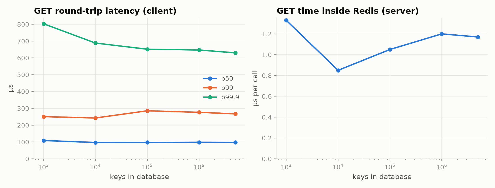
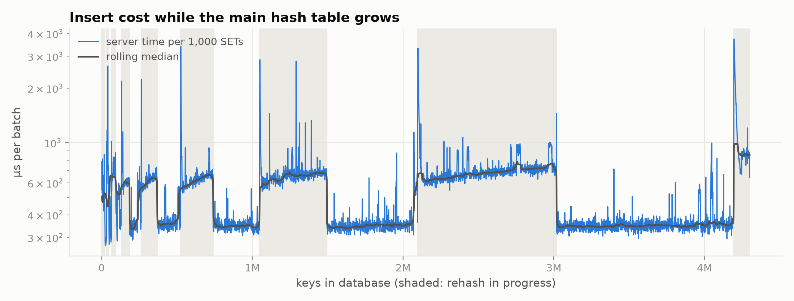
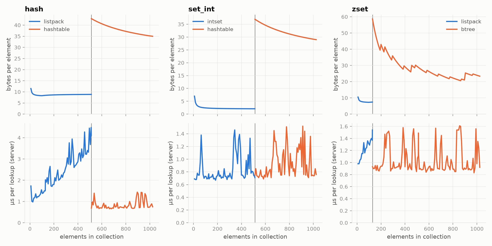
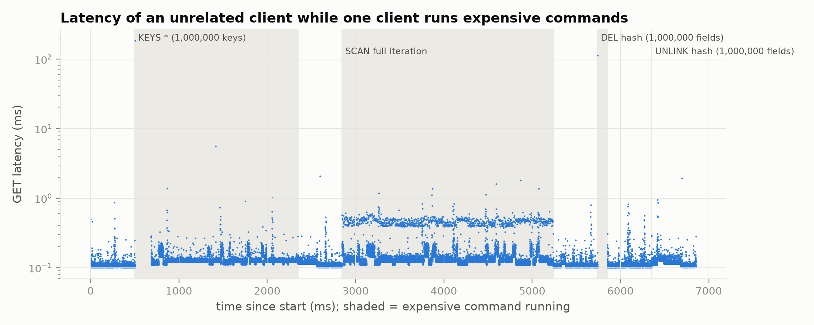
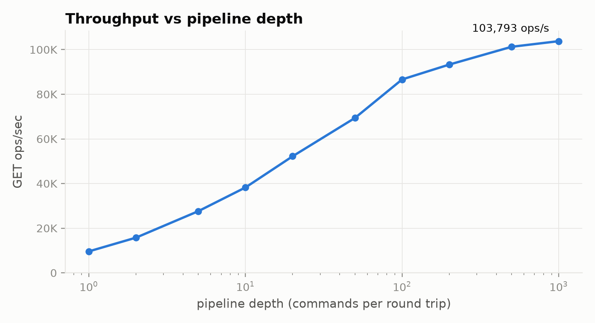
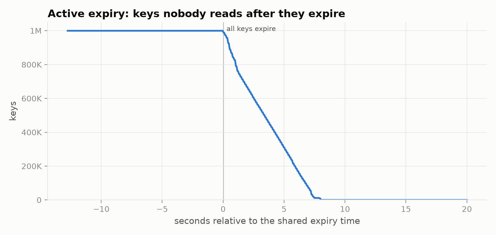

# Redis experiments: run `20261114-014947`

Redis `255.255.255` (sha `ee8e7f70`), io-threads=1, quick=False, host `omarchy`, 2026-11-14T01:49:47 → 2026-11-14T01:53:37.

## 1. Lookup cost vs. key count

- Server-side GET time ranged 0.85–1.33 µs across 1K–5M keys (max/min = 1.56×). Effectively flat, as expected for an O(1) hash lookup.
- Client round-trip p50 is ~84× the server time. Most of what a client sees is network, syscalls and client-library overhead, not the lookup.
- Memory grew to 350 MB at 5M keys (~73 B/key including overhead).



|       keys |   client_p50_us |   client_p99_us |   client_p999_us |   client_mean_us |   server_usec_per_call |   used_memory_mb |
|-----------:|----------------:|----------------:|-----------------:|-----------------:|-----------------------:|-----------------:|
|   1000     |          108.81 |          250.84 |           802.91 |           117.16 |                   1.33 |              1   |
|  10000     |           97.2  |          242.83 |           688.27 |           105.34 |                   0.85 |              1.6 |
| 100000     |           97.44 |          285.58 |           651.77 |           109.74 |                   1.05 |              7   |
|      1e+06 |           98.34 |          276.54 |           647.05 |           109.77 |                   1.2  |             67   |
|      5e+06 |           97.85 |          267.29 |           630.21 |           108.21 |                   1.17 |            350.1 |

## 2. Hash table resizing (rehash)

- 4,300 batches of 1,000 SETs. Median server time 384 µs/batch (client saw 9,569 µs, so the client and network add most of it).
- 12 rehash periods detected. Each starts when the key count reaches a power of two (the table doubles).
- Median batch during rehash: 668 µs vs 349 µs outside. That difference is the cost of incremental migration: every write also moves a few buckets to the new table.
- The cost is spread over the whole rehash period rather than one big pause, so you see a plateau, not a spike. The one-off cost is allocating the new bucket array (8 bytes × 2^k).



|   rehash starts at keys | nearest 2^k   |   lasted (keys inserted) | new table overhead   |   worst server_batch_us inside | vs rolling median   |
|------------------------:|:--------------|-------------------------:|:---------------------|-------------------------------:|:--------------------|
|                   3,000 | 2^12          |                    1,000 | 0.0 MB               |                            679 | 1.4×                |
|                   5,000 | 2^12          |                    2,000 | 0.0 MB               |                            813 | 1.7×                |
|                   9,000 | 2^13          |                    2,000 | 0.1 MB               |                            662 | 1.3×                |
|                  17,000 | 2^14          |                    5,000 | 0.1 MB               |                            861 | 1.7×                |
|                  33,000 | 2^15          |                   13,000 | 0.2 MB               |                           2650 | 6.0×                |
|                  66,000 | 2^16          |                   27,000 | 0.5 MB               |                           1017 | 1.5×                |
|                 132,000 | 2^17          |                   53,000 | 1.0 MB               |                           2187 | 3.8×                |
|                 263,000 | 2^18          |                  105,000 | 2.0 MB               |                           2237 | 4.0×                |
|                 525,000 | 2^19          |                  215,000 | 4.0 MB               |                           3403 | 6.1×                |
|               1,049,000 | 2^20          |                  445,000 | 8.0 MB               |                           2872 | 5.2×                |
|               2,098,000 | 2^21          |                  920,000 | 16.0 MB              |                           3325 | 4.9×                |
|               4,195,000 | 2^22          |                  106,000 | 32.0 MB              |                           3739 | 4.0×                |

Final `DEBUG HTSTATS 0`:

```
[Dictionary HT]
Hash table 0 stats (main hash table):
 table size: 4194304
 number of elements: 3962738
Hash table 1 stats (rehashing target):
 table size: 8388608
 number of elements: 337262
[Expires HT]
```

## 3. Encoding conversions (compact → hash table)

- hash: `listpack` → `hashtable` at 513 elements; total memory jumps 4.85× (8.9 → 42.9 B/element), lookup 4.11 → 0.69 µs.
- set_int: `intset` → `hashtable` at 513 elements; total memory jumps 17.77× (2.1 → 36.9 B/element), lookup 0.71 → 0.75 µs.
- zset: `listpack` → `btree` at 129 elements; total memory jumps 7.95× (7.4 → 58.7 B/element), lookup 1.54 → 0.93 µs.
- Compact encodings scan linearly (lookup cost grows with size) but are dense. Hash tables are O(1) but cost more per element. The config limits pick the crossover: `hash-max-listpack-entries`=512, `set-max-intset-entries`=512, `zset-max-listpack-entries`=128.



| type    | from     | to        |   at_elements |   bytes/elem before |   bytes/elem after | memory jump   |   lookup µs before |   lookup µs after |
|:--------|:---------|:----------|--------------:|--------------------:|-------------------:|:--------------|-------------------:|------------------:|
| hash    | listpack | hashtable |           513 |                 8.9 |               42.9 | 4.85×         |               4.11 |              0.69 |
| set_int | intset   | hashtable |           513 |                 2.1 |               36.9 | 17.77×        |               0.71 |              0.75 |
| zset    | listpack | btree     |           129 |                 7.4 |               58.7 | 7.95×         |               1.54 |              0.93 |

## 4. Single-threaded blocking

- Background GET p50 when idle: 118 µs.
- KEYS * (1,000,000 keys): 183.441 ms inside Redis (1,844.8 ms seen by its client); worst concurrent GET 183.9 ms (1,553× normal).
- SCAN full iteration: 355.026 ms inside Redis (2,392.5 ms seen by its client); worst concurrent GET 1.8 ms (15× normal).
- DEL hash (1,000,000 fields): 112.4 ms inside Redis (112.8 ms seen by its client); worst concurrent GET 112.8 ms (953× normal).
- UNLINK hash (1,000,000 fields): 0.011 ms inside Redis (0.2 ms seen by its client); worst concurrent GET 0.3 ms (2× normal).
- KEYS blocks the event loop for the whole scan. SCAN does more total work but in small steps, so other clients get in between. UNLINK hands the free to a background thread; DEL frees every field on the main thread.



| command                        |   command_ms |   server_ms |   concurrent GETs |   worst GET stall ms | stall vs normal p50   |
|:-------------------------------|-------------:|------------:|------------------:|---------------------:|:----------------------|
| KEYS * (1,000,000 keys)        |     1844.76  |     183.441 |             12589 |                183.9 | 1,553×                |
| SCAN full iteration            |     2392.48  |     355.026 |             14964 |                  1.8 | 15×                   |
| DEL hash (1,000,000 fields)    |      112.834 |     112.4   |                15 |                112.8 | 953×                  |
| UNLINK hash (1,000,000 fields) |        0.219 |       0.011 |                14 |                  0.3 | 2×                    |

## 5. Pipelining

- Unpipelined: 9,624 ops/s, i.e. one round trip ≈ 104 µs.
- Peak 103,793 ops/s at depth 1000 (10.8×). 90% of peak by depth 500.
- Past the knee the bottleneck is the client (Python encoding/parsing replies), not Redis. Compare with `redis-benchmark -P 100` to see the server's own limit.



|   depth |    ops |   seconds |   ops_per_sec |
|--------:|-------:|----------:|--------------:|
|       1 |  50000 |     5.195 |          9624 |
|       2 | 200000 |    12.678 |         15775 |
|       5 | 200000 |     7.237 |         27638 |
|      10 | 200000 |     5.227 |         38261 |
|      20 | 200000 |     3.829 |         52230 |
|      50 | 200000 |     2.882 |         69400 |
|     100 | 200000 |     2.308 |         86650 |
|     200 | 200000 |     2.143 |         93308 |
|     500 | 200000 |     1.975 |        101273 |
|    1000 | 200000 |     1.927 |        103793 |

## 6. Key expiry without access

- 1,000,000 keys all set to expire at the same instant (PXAT), never read again; hz=10.
- Time after expiry until 50% removed: 3.46s; 99%: 7.97s; 100%: 8.14s.
- Removal rate mid-curve ≈ 126,872 keys/s.
- Expired-but-unread keys are only removed by the background cycle, which runs `hz` times a second under a CPU-time budget. Until then they still use memory and count in DBSIZE. Raising `active-expire-effort` or `hz` speeds this up at the cost of CPU.
- Memory: 104.2 MB → 1.1 MB.


