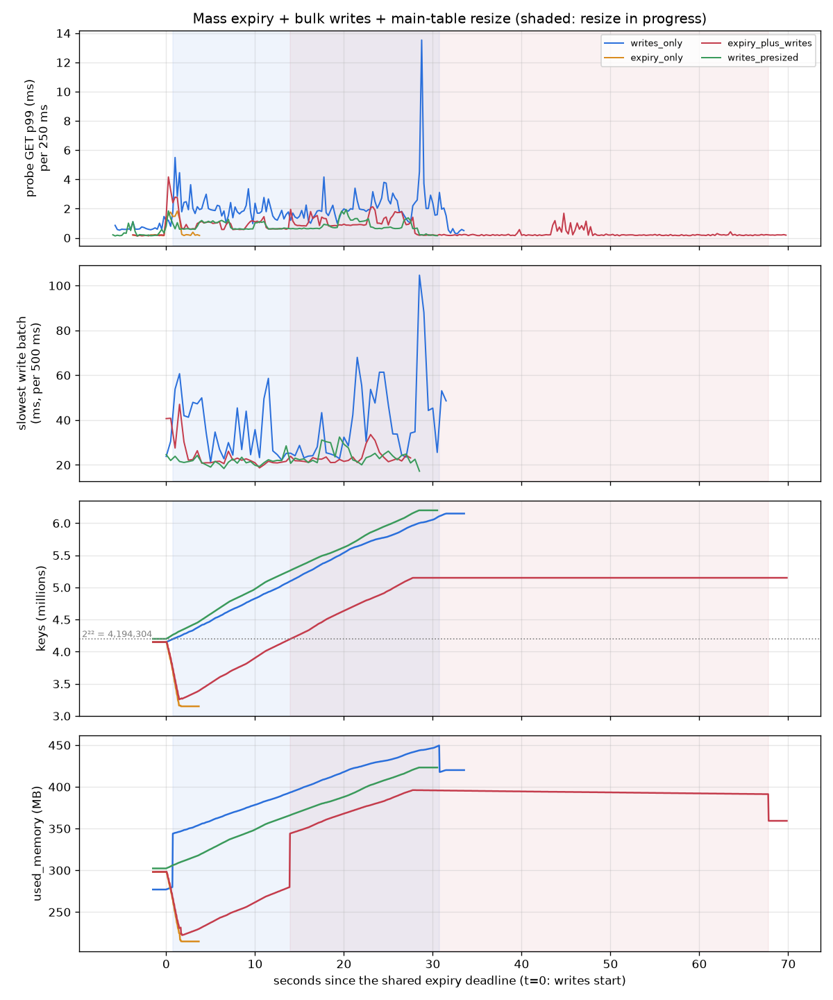

# expiry_load: 20261114-024346

hz=10, active-expire-effort=1, 2,000,000 new keys from 2 writer processes (pipelined, 1000/batch).

## Per scenario

| scenario           |   start_keys |   peak_keys |   end_keys |   main_table_start |   main_table_end |   resize_start_s |   resize_end_s |   expiry_done_s |   writes_done_s |   write_keys_per_s |   batch_p50_ms |   batch_p99_ms |   batch_max_ms |   mem_start_mb |   mem_peak_mb |   mem_end_mb |   rehash_overhead_peak_mb | expires_table_sizes     |   server_set_us |
|:-------------------|-------------:|------------:|-----------:|-------------------:|-----------------:|-----------------:|---------------:|----------------:|----------------:|-------------------:|---------------:|---------------:|---------------:|---------------:|--------------:|-------------:|--------------------------:|:------------------------|----------------:|
| writes_only        |      4150000 |     6150000 |    6150000 |            4194304 |          8388608 |             0.74 |          30.77 |          nan    |           31.51 |              63472 |           20.4 |           53.7 |          104.6 |          277   |         449.6 |        420.1 |                        32 |                         |            1.31 |
| expiry_only        |      4150000 |     4150000 |    3150000 |            4194304 |          4194304 |           nan    |         nan    |            1.66 |          nan    |                nan |          nan   |          nan   |          nan   |          298.1 |         298.1 |        214.8 |                         8 | 1,048,576 → 131,072 → 0 |          nan    |
| expiry_plus_writes |      4150000 |     5150000 |    5150000 |            4194304 |          8388608 |            13.93 |          67.8  |            1.78 |           27.75 |              72072 |           19.7 |           29.5 |           47   |          298.2 |         396.1 |        359.3 |                        32 | 1,048,576 → 131,072 → 0 |            0.74 |
| writes_presized    |      4200000 |     6200000 |    6200000 |            8388608 |          8388608 |           nan    |         nan    |          nan    |           28.46 |              70274 |           20   |           29.3 |           32.4 |          302.3 |         423.2 |        423.2 |                         0 |                         |            0.57 |

## Probe GET latency by phase (single GETs from a separate process)

| scenario           | phase             |   samples |   p50_us |   p99_us |   p99.9_us |   max_ms |
|:-------------------|:------------------|----------:|---------:|---------:|-----------:|---------:|
| writes_only        | baseline (t<0)    |     34776 |    123.7 |    668.7 |     2190.5 |     5.2  |
| writes_only        | main-table rehash |    109963 |    184.5 |   2031.8 |     4490.3 |    18.16 |
| writes_only        | neither           |      6391 |    149.5 |   1613.5 |     4132   |    10.53 |
| expiry_only        | baseline (t<0)    |     32499 |    113.2 |    176.7 |      445.4 |     7.33 |
| expiry_only        | expiry running    |      4920 |    123.9 |   1494.6 |    26685.5 |    27.92 |
| expiry_plus_writes | baseline (t<0)    |     33899 |    102.9 |    171.3 |      406   |     4.83 |
| expiry_plus_writes | expiry running    |      4606 |    132.3 |   2599.5 |    28051   |    29.03 |
| expiry_plus_writes | main-table rehash |    412484 |    111.4 |    355.5 |     1550.7 |    48.46 |
| expiry_plus_writes | neither           |     72966 |    131.4 |    941.6 |     1880.2 |     6.51 |
| writes_presized    | baseline (t<0)    |     47908 |    103.8 |    344.5 |     1026.8 |     9.76 |
| writes_presized    | neither           |    165278 |    139.6 |    908   |     1858.6 |    53.61 |

