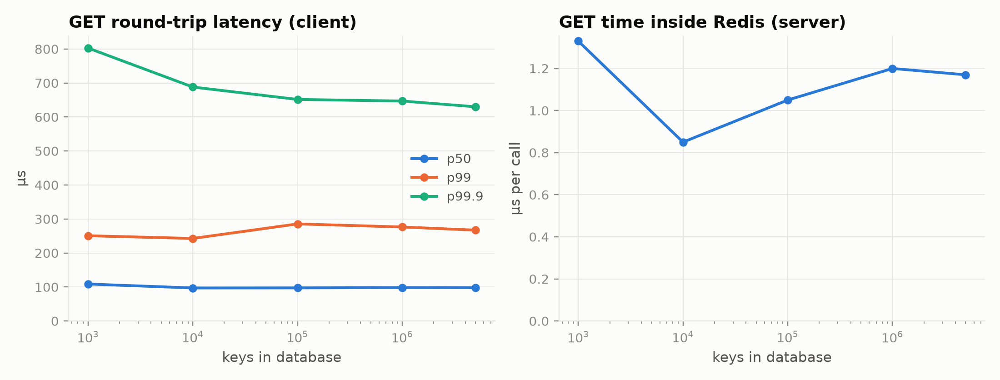
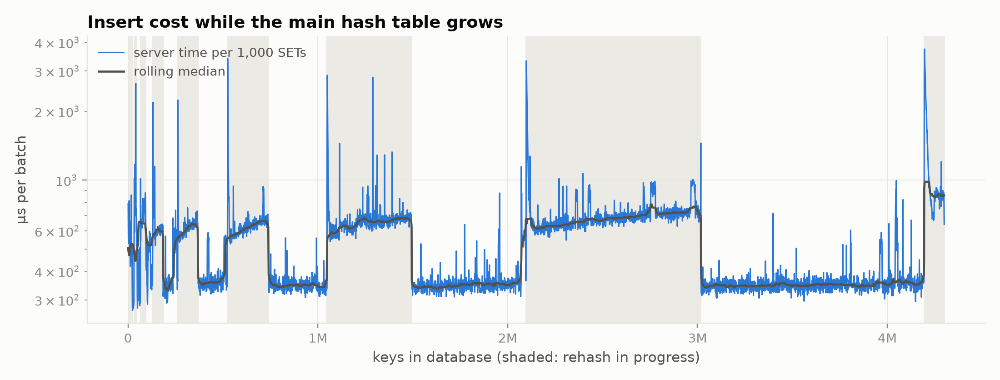
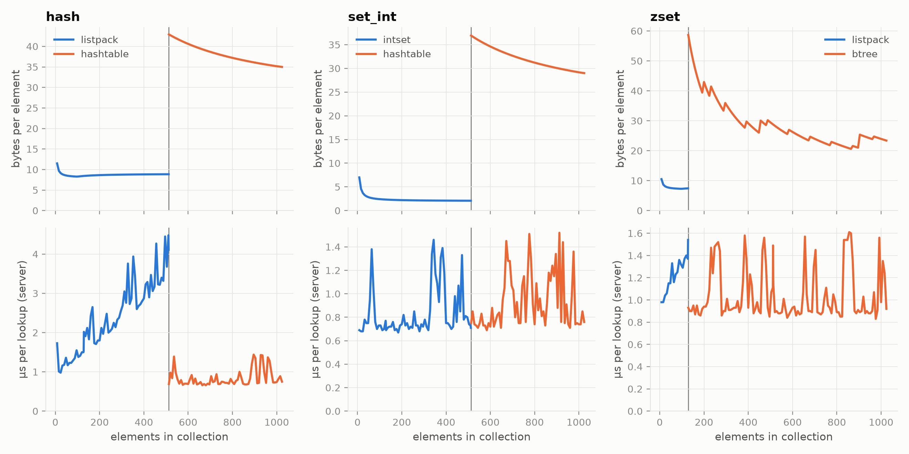
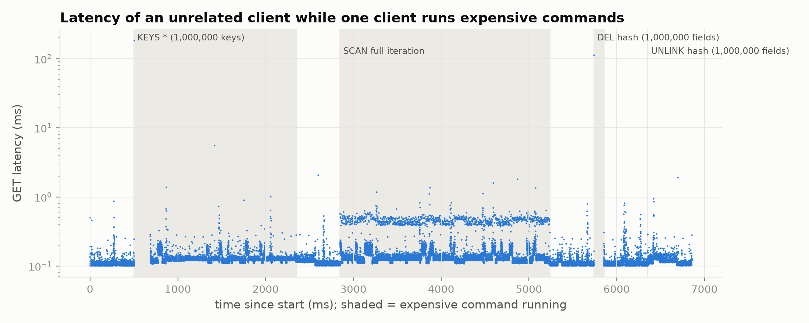
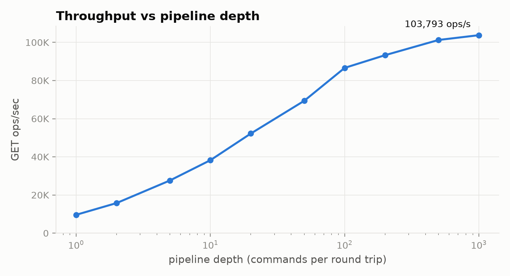
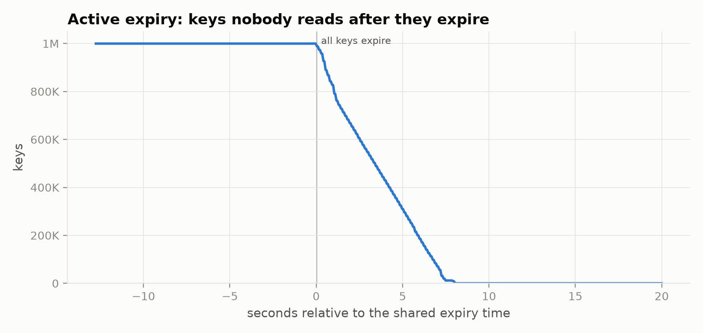

# I built Redis from source and poked at how it finds keys. Here's what I found.

*Six small experiments on an old laptop, and one bug in my own benchmark that almost fooled me.*

---

Everyone says Redis is fast. GET is O(1), it's all in memory, done. I've used it for caching for a while and never really looked past that. So one weekend I decided to clone the repo, build it myself, and actually measure what happens when you ask it for a key.

I didn't want to read blog posts about Redis internals. I wanted to see the numbers on my own machine and then go find the code that explains them.

My setup is nothing special. It's a 2015 laptop with an i5-5350U (2 cores, 4 threads) and 8 GB of RAM, running Linux. Client and server are on the same machine, talking over loopback.

## Setup

I cloned `github.com/redis/redis` and built it with plain `make`. I was on the `unstable` branch (commit `ee8e7f70`), so `INFO` reports the version as `255.255.255`, which confused me for a minute. It builds with jemalloc by default.

The config was kept minimal on purpose:

```
port 6379
bind 127.0.0.1
save ""
appendonly no
enable-debug-command local
latency-monitor-threshold 1
slowlog-log-slower-than 1000
```

Persistence is off so snapshots don't add noise. I turned on `DEBUG` for localhost because `DEBUG POPULATE` creates millions of keys in a couple of seconds, and `DEBUG HTSTATS` shows you the hash table itself. Everything else is default: `hz 10`, `active-expire-effort 1`, `activerehashing yes`, one I/O thread.

The test runner is a Python script (redis-py 8.1) that runs each experiment, writes raw CSVs, and a second script turns those into charts. Each experiment starts with `FLUSHALL`.

One thing I learned early: **don't trust the latency your client sees.** From Python, a GET round trip was about 98 µs. Inside Redis, the same GET took about 1.2 µs. So for anything about Redis itself, I used the server's own counters from `INFO commandstats` and ignored my client's timer.

## 1. Is GET really O(1)?

I filled the database to 1K, 10K, 100K, 1M and 5M keys and did 10,000 random GETs at each size.



Server-side time stayed between **0.85 and 1.33 µs** the whole way. At 5M keys it was about the same as at 1K. Memory came out to around 73 bytes per key including all the overhead (350 MB for 5M keys).

So yes, O(1). Nothing surprising, but it was nice to see it hold. The bigger lesson was that the round trip costs about **84× more than the lookup**. If your Redis calls feel slow, the lookup is almost never the reason.

## 2. What happens when the hash table grows

This is the experiment I was most curious about and the one I'd recommend if you try only one.

Redis keeps all keys in a hash table (`src/dict.c`). When the number of keys reaches the table size, which is always a power of two, it creates a new table twice as big and moves everything over. If it did that all at once with 4 million keys, the server would freeze. So it does it **incrementally**: every command after that moves a few buckets to the new table, until the old one is empty.

I wanted to see that. So I inserted 4.3M keys in batches of 1,000 and after each batch I recorded two things:

- how much server time the batch took (the change in `cmdstat_set` usec)
- `mem_overhead_db_hashtable_rehashing` from `INFO memory`, which is non-zero only while a rehash is in progress



The shaded parts are where a rehash was running, and they line up perfectly with powers of two: 131K, 262K, 524K, 1M, 2M, 4M. Inside them, a batch of 1,000 SETs costs **668 µs instead of 349 µs**, almost 2×.

What I didn't expect was how *long* it lasts. It isn't a spike. It's a plateau that goes on for hundreds of thousands of inserts:

| Resize at | Started at keys | Lasted (inserts) | New table |
|---|---|---|---|
| 2^18 | 263,000 | 105,000 | 2 MB |
| 2^19 | 525,000 | 215,000 | 4 MB |
| 2^20 | 1,049,000 | 445,000 | 8 MB |
| 2^21 | 2,098,000 | 920,000 | 16 MB |

Each one lasted for about 0.41× the table size. There is a short spike at the start of each plateau (up to ~6× normal), which is allocating the new bucket array.

The run ended right in the middle of the 2^22 resize, so `DEBUG HTSTATS` caught Redis with keys in two tables at once:

```
Hash table 0 stats (main hash table):
 table size: 4194304
 number of elements: 3962738
Hash table 1 stats (rehashing target):
 table size: 8388608
 number of elements: 337262
```

Seeing that output after reading about incremental rehashing was probably my favourite moment of the whole thing.

## 3. Small collections are stored differently

A hash with a few fields isn't stored as a hash table at all. Redis packs it into a `listpack`, basically a flat byte array that it scans from the start. Lookups get slower as it grows, but it uses far less memory. Once it passes a limit (`hash-max-listpack-entries`, 512 on this build) Redis converts it into a real hash table.

I created hashes, integer sets and sorted sets at every size from 8 to 1,024 and measured memory and lookup time.



You can see the linear scan clearly. HGET goes from about 1 µs to **4.1 µs at 512 fields**, then drops to **0.7 µs at 513** when it becomes a hash table. Memory goes the other way:

| Type | Conversion | At | Bytes per element | Memory jump |
|---|---|---|---|---|
| Hash | listpack → hashtable | 513 | 8.9 → 42.9 | 4.9× |
| Set of integers | intset → hashtable | 513 | 2.1 → 36.9 | 17.8× |
| Sorted set | listpack → btree | 129 | 7.4 → 58.7 | 7.9× |

The integer set one is wild: adding one element made the key 17.8× bigger.

Also, notice the sorted set says **btree**. I expected `skiplist`, which is what every Redis article talks about. It turns out the unstable branch now stores large sorted sets in a packed B+ tree (`src/zset_btree.c`). I found that by accident, which is a good argument for building from source.

## 4. One slow command, everyone waits

Redis runs commands on a single thread. Everyone knows "don't run KEYS in production", but I wanted to see how bad it is.

I loaded 1M keys. A separate process sent GETs nonstop (normally ~118 µs each, round trip) while my main client ran four commands. I recorded the longest wait the GET process saw during each one.



| Command | Longest wait for the other client |
|---|---|
| `KEYS *` on 1M keys | **184 ms** |
| `SCAN` over all keys | 1.8 ms |
| `DEL` on a hash with 1M fields | **113 ms** |
| `UNLINK` on the same hash | 0.3 ms |

`SCAN` actually did *more* total work than `KEYS` (355 ms of server time vs 183 ms), but in small chunks, so other clients get served in between. `UNLINK` passes the actual freeing to a background thread and returns immediately.

### The bug that almost fooled me

My first version of this test ran the GET prober as a **thread** in the same Python process. The results said KEYS blocked for about 600 ms, but the GETs during it were scattered around 3 to 50 ms, which made no sense. If Redis is single-threaded, they should all wait the full time.

It was Python's GIL. While my main thread was parsing a 300K-element reply from KEYS, the prober thread couldn't run, so I was measuring Python, not Redis. Moving the prober to a separate **process** fixed it, and then the numbers matched exactly: KEYS spent 183.4 ms inside Redis, and the other client waited 183.9 ms.

If you benchmark anything from Python with threads, watch out for this.

## 5. Pipelining

Sending one command per round trip got me about 9,600 GETs per second. Sending 1,000 per round trip got me about 104,000.



That's 10.8×, and past a few hundred the limit was my Python client encoding and parsing, not Redis. `redis-benchmark` would show a much higher ceiling.

## 6. Expired keys don't leave right away

I wrote 1M keys that all expire at the same instant (using `PXAT` so they share one deadline) and then never touched them again.

My first attempt used a 3 second TTL, but writing 1M keys took longer than that, so keys written first expired before the last ones were even written. Using one absolute deadline fixed that.



Half of them were gone after **3.5 seconds**, and all of them after **8.1 seconds**. Until then they were still using memory (104 MB at the start). Keys nobody reads are only removed by a background cycle that runs 10 times a second (`hz`) with a CPU budget, at about 127K keys/second here.

So if you write a lot of short-lived keys, memory can stay higher than you'd expect for a few seconds after they expire.

## What I'd take away

- The lookup is ~1 µs. Your network and client are almost everything else.
- Growing past a power of two makes writes ~2× more expensive for a long stretch. If you know you're loading millions of keys, that's worth knowing.
- The compact encodings are a real memory vs CPU trade, and the limits are configurable.
- `SCAN` over `KEYS`, `UNLINK` over `DEL` for big keys. Now I've seen why.
- Expired doesn't mean freed.

Caveat: this is one run on one laptop with CPU frequency scaling on. Don't take the absolute numbers too seriously; the shapes and ratios are the interesting part.

Next I want to try raising `hz` and `active-expire-effort` to see how much faster expiry gets, and compare the new B+ tree sorted set with the old skiplist from Redis 7.2.

All the scripts are here if you want to run it yourself: https://github.com/divyanshbhadauria/redis-key-lookup-experiments
